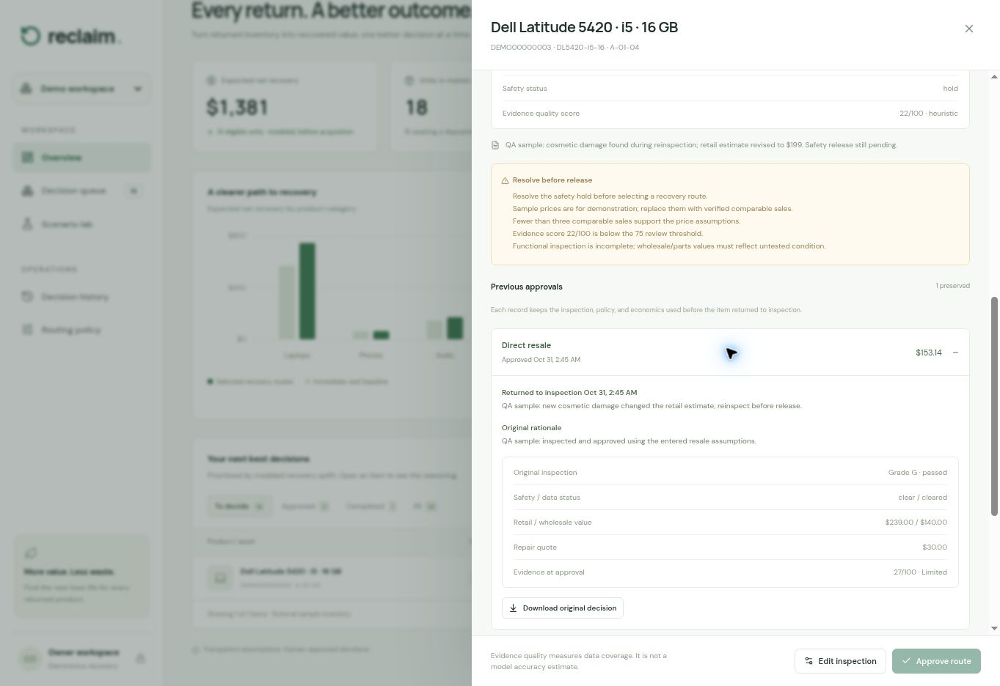

# Verification record

## Browser workflow checks

The following workflows were exercised in the managed local browser preview during implementation:

| Check | Result |
| --- | --- |
| Demo and live workspace separation | Passed: fictional demo inventory and the live workspace remain separate |
| New return intake and persistence | Passed after the intake-ID compatibility fix: a new return saved successfully and remained after a full browser reload |
| Explicit route override | Passed: an approved alternative route retains its own frozen economics |
| Actual recovery outcome and history | Passed: entered proceeds/costs update realized economics and append an audit event |
| Repair-cost scenario | Passed: the tested repair-cost scenario changed the iPhone recommendation from refurbishment to wholesale |
| Held unit | Passed: the held unit remains blocked from outbound approval |

These are local preview checks, not evidence of a live marketplace transaction, production load capacity, or trained-model accuracy.

## Baseline application verification

The following results describe the initial application before the contributor/CI and controlled-reinspection changes:

| Gate | Status |
| --- | --- |
| Full decision/CSV/backend regression suite | Passed after the final intake-ID compatibility fix: 34 tests total — 12 decision-engine, 12 CSV, and 10 backend |
| TypeScript check | Passed: `tsc --noEmit` exited successfully |
| Production build | Passed: the production build exited successfully |
| Hosted deployment | Passed: private release `appgdep_6ae5a27b30dc8191a4974de1943d1778` succeeded |

Hosted publication is verified separately by the deployment result reported with a release; this record does not assert that publication has completed.

## Contributor and CI workflow

`npm run check` was executed successfully after adding the repeatable package scripts and controlled-reinspection support: all 43 regression tests ran as individual cases (12 engine, 15 CSV, 16 backend), followed by a successful `tsc --noEmit`. The workflow YAML was parsed and its event triggers, read-only permission, pinned actions, Node version, and credential setting were checked. The package rename and Node 24 runtime declaration are consistent between `package.json` and `package-lock.json`; no dependency versions changed.

The GitHub workflow is configured to run tests, type-check, and build. It has only `contents: read` permission, does not persist checkout credentials, and has no deployment step. Official action versions were verified against their release and commit pages:

| Action | Pinned version and source |
| --- | --- |
| `actions/checkout` | [v7.0.0 release](https://github.com/actions/checkout/releases/tag/v7.0.0), commit [`9c091bb21b7c1c1d1991bb908d89e4e9dddfe3e0`](https://github.com/actions/checkout/commit/9c091bb21b7c1c1d1991bb908d89e4e9dddfe3e0) |
| `actions/setup-node` | [v7.0.0 release](https://github.com/actions/setup-node/releases/tag/v7.0.0), commit [`820762786026740c76f36085b0efc47a31fe5020`](https://github.com/actions/setup-node/commit/820762786026740c76f36085b0efc47a31fe5020) |

The test invocation uses [Node 24's documented test-isolation mode](https://nodejs.org/docs/latest-v24.x/api/test.html#test-runner-execution-model) to import the test modules into the runner process and report their individual cases.

| Current release gate | Status |
| --- | --- |
| Complete regression suite after controlled-reinspection changes | Passed: 43 tests through `npm run check` |
| TypeScript after controlled-reinspection changes | Passed: `npm run typecheck` exited successfully |
| Production build after all current application changes | Passed: Sites production build exited successfully |
| Browser approval/reinspection workflow | Passed in the managed local preview: original approval archived, new safety hold enforced, revised economics evaluated after clearance, and a new approval created |
| GitHub CI | Pending first verified remote run |
| Updated hosted deployment | Pending release verification |

The browser example approved a fictional Dell at $153.14 expected net recovery, reopened it with a reason, and reduced its entered retail price from $239 to $199. All routes were blocked while the safety hold remained. After diagnostics and safety clearance, expected direct-resale net recovery became $126.81, while the original $153.14 decision and $239 price input remained visible in the archived approval. These are synthetic workflow checks, not recovered revenue.

## Scope limits

No marketplace execution, live market-data ingestion, ML training, load test, external penetration test, or environmental-impact validation is claimed. The workspace byte cap and separate unit-count bound are documented in the README.
